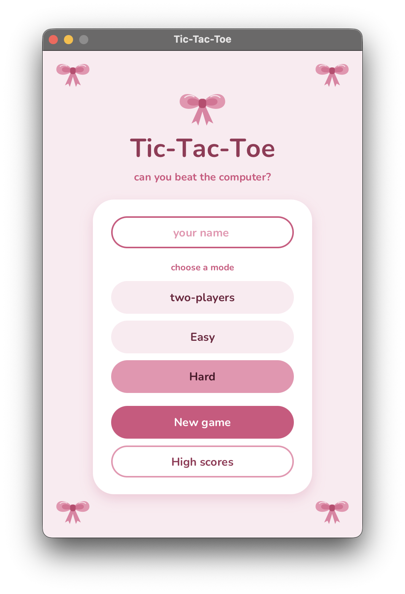
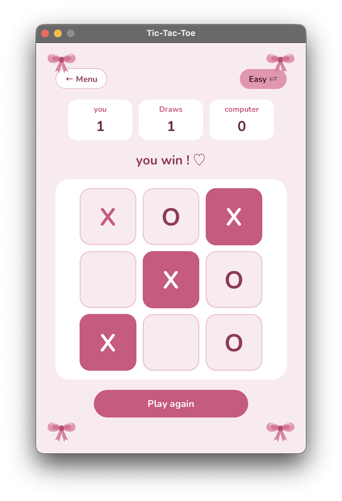
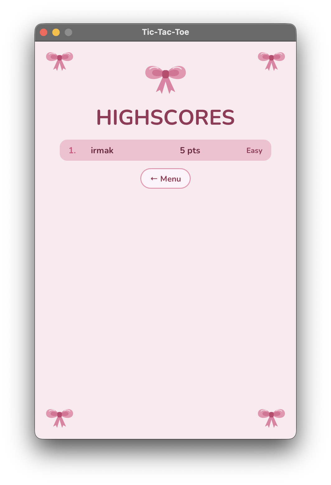

<h1 align="center">🎀 Tic-Tac-Toe Minimax</h1>

<p align="center">
  A pink Tic-Tac-Toe game in Java with an <b>unbeatable minimax AI</b>, a JavaFX interface and a local high score table.
</p>

<p align="center">
  
  
  
</p>

---

## ✨ Features

- **Three modes:** 2 players, Easy (random computer) and Hard (unbeatable minimax computer)
- **Switch difficulty in game** between Easy and Hard without losing the score
- **Score cards** for X, O and draws during a session
- **High scores:** enter your name to save your session to a top 10 table
- **Winning line highlight** and a small pop animation on every move
- **Console version** included, playable in the terminal

## 🧠 How the minimax AI works

Before every move, the computer tries every possible move and plays the game out to the end in its head. Each final position gets a score:

| Result | Score |
|---|---|
| Computer wins | +10 |
| Draw | 0 |
| Player wins | −10 |

On its own turn the computer picks the move with the **highest** score, and it assumes the player will always pick the move with the **lowest** score. Because Tic-Tac-Toe is small enough to search completely, the computer never loses: the best you can do is a draw.

## 🏆 Scoring

Points are collected during a session (from **New game** until you return to the menu or close the window):

| Result | Points |
|---|---|
| Win in Easy or 2 players mode | +1 |
| Draw in Hard mode | +3 |
| Win in Hard mode | +5 |

Sessions are only saved when a name is entered. Scores are stored locally on your computer with the Java Preferences API.

## 🚀 How to run

**Requirements:** JDK 23 or later and Maven (or IntelliJ IDEA, which includes Maven).

```bash
git clone https://github.com/irmakonder/tic-tac-toe-minimax.git
cd tic-tac-toe-minimax
mvn javafx:run
```

Or open the project in IntelliJ IDEA and run:
- `Launcher` → JavaFX version
- `Main` → console version

## 🛠️ Built with

- Java 26
- JavaFX 25 (UI) and JavaFX CSS (styling)
- Maven
- [Nunito](https://fonts.google.com/specimen/Nunito) font (SIL Open Font License)

## 📁 Project structure

```
src/main/java/
├── Board.java          # grid, moves, winner and draw checks
├── Player.java         # interface for anything that can choose a move
├── HumanPlayer.java    # console input
├── RandomAI.java       # easy mode
├── MinimaxAI.java      # hard mode
├── Game.java           # console game loop
├── Main.java           # console entry point
├── TicTacToeApp.java   # JavaFX screens and game logic
├── Launcher.java       # JavaFX entry point
├── ScoreEntry.java     # record for one high score
└── Leaderboard.java    # top 10 scores, saved with Preferences
src/main/resources/
├── styles.css
└── fonts/
```

## 📌 Versions

- **v1.0** – Console version
- **v2.0** – JavaFX version with pink UI, score cards and high scores

## 📄 License

This project is licensed under the MIT License.
